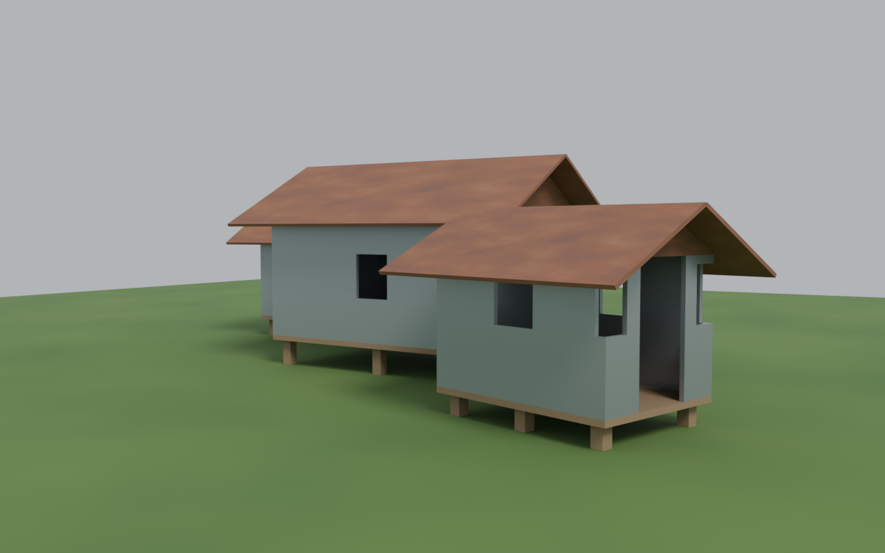
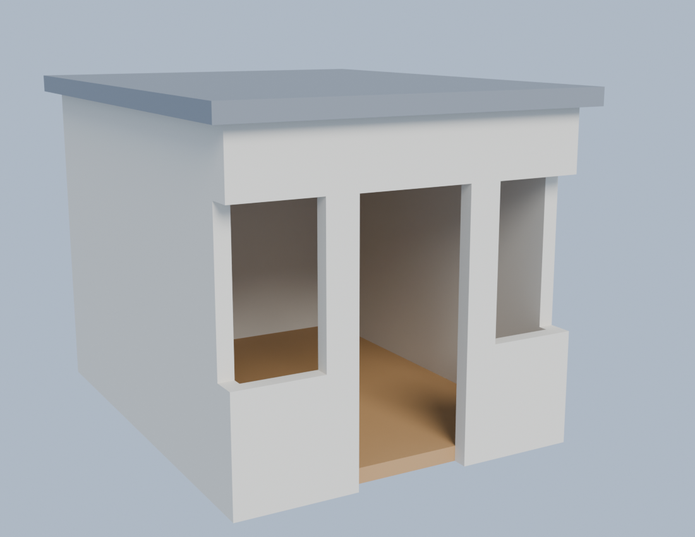
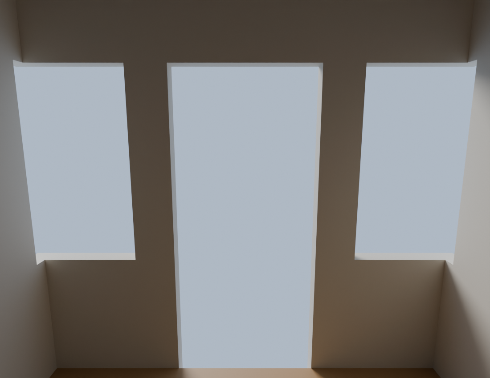
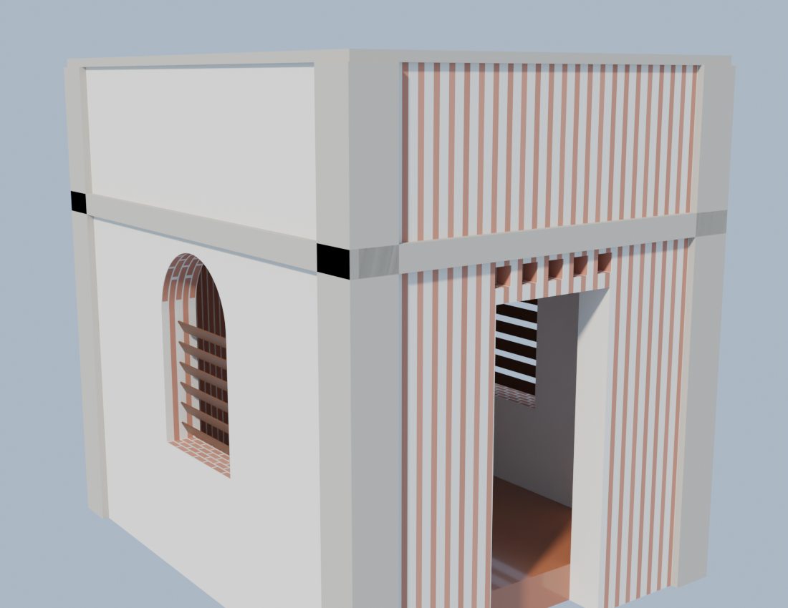
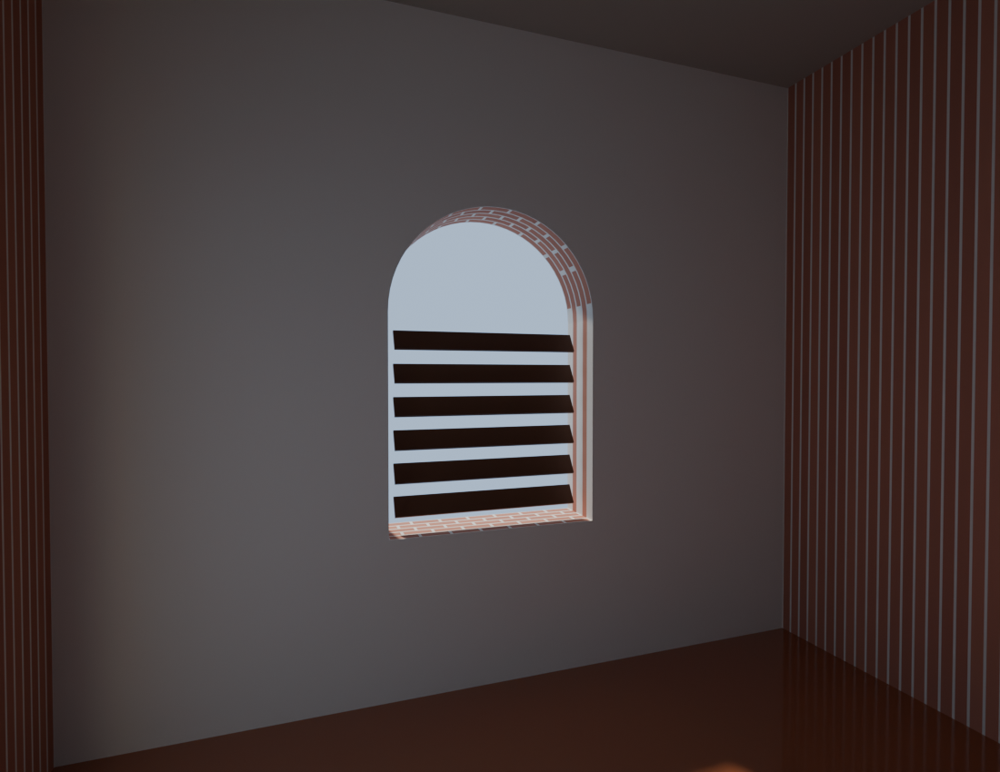
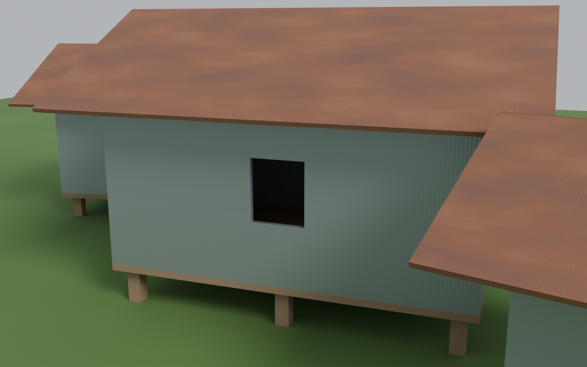

# Buildings written in Python, with [sand3d](https://github.com/Sandflow-ai/sand3d)

Three parametric buildings — from a plain concrete room to a brick Dhaka-style house
to a village of tin-roofed stilt houses — each modeled as a short Python program with
[sand3d](https://github.com/Sandflow-ai/sand3d) (Blender-as-a-library), and rendered
with Cycles on GPU. Every geometry you see below is **real booleaned solid geometry**,
not an image prompt: arched openings, parapets, vent blocks, gables, stilts, cavities.



## The three builds

### 1. Plain room — `examples/room.py` (20 lines)

A concrete shell with an oak floor and a flat roof. One door cavity, two window
cavities — cut in a single `pocket` call with a list of frames.

| Exterior | Interior |
|---|---|
|  |  |

### 2. Dhaka brick house — `examples/room_bd.py` (~35 lines)

The Bangladeshi RC-frame idiom: exposed 250 mm brick infill, corner pilasters and a
lintel band in concrete, arched windows with louvered wooden shutters, vent blocks
over the door, a parapet with coping, and a raised plinth. The brick and mortar in the
renders are a procedural texture layered on in the render script.

| Exterior | Interior |
|---|---|
|  |  |

### 3. Tin hamlet — `examples/tin_hamlet.py` (~50 lines)

A village cluster of corrugated-tin houses like rural Bangladesh's *tin-ghor*: one
parametric `tin_house()` — timber stilts, plank deck, tin shell, tin gable triangles,
two roof planes with 500 mm eaves, door and window cavities — instantiated three times
at different sizes and rotations, set on a rice-paddy plane under monsoon haze.



## Run it

```bash
uv venv --python 3.13          # sand3d wants 3.13 (or 3.11; no 3.12)
uv pip install sand3d          # brings Blender's bpy module with it

python examples/room.py        # writes models/room.glb
python examples/room_bd.py     # writes models/room_bd.glb
python examples/tin_hamlet.py  # writes models/tin_hamlet.glb
```

Prebuilt GLBs are in [`models/`](models/) — open them in Blender, three.js, or any
glTF viewer.

## Render it

The Cycles render scripts (GPU/OptiX if available) take a GLB, an output PNG, and a
mode, and layer on the textures the GLB materials hint at: brick, corrugated tin,
rust patina, grass, haze.

```bash
python render/render_tin.py models/tin_hamlet.glb images/hamlet_wide.png wide
python render/render_tin.py models/tin_hamlet.glb images/hamlet_close.png close
python render/render_bd.py models/room_bd.glb images/room_bd_exterior.png exterior
```

## Why sand3d

The whole hamlet is ~50 lines; the brick house ~35; the room 20. Millimetre units,
parts by name, no hand-computed coordinates, deterministic output — and every verb
from `extrude` to `joint` fits in a ~3,600-token API summary, which is exactly why
these programs can be written by an LLM (these were).

## Credits

- [sand3d](https://github.com/Sandflow-ai/sand3d) by Sandflow AI — the modeling
  library (Apache-2.0). The `bpy` module is Blender, by the Blender Foundation.
- Code here: MIT.
